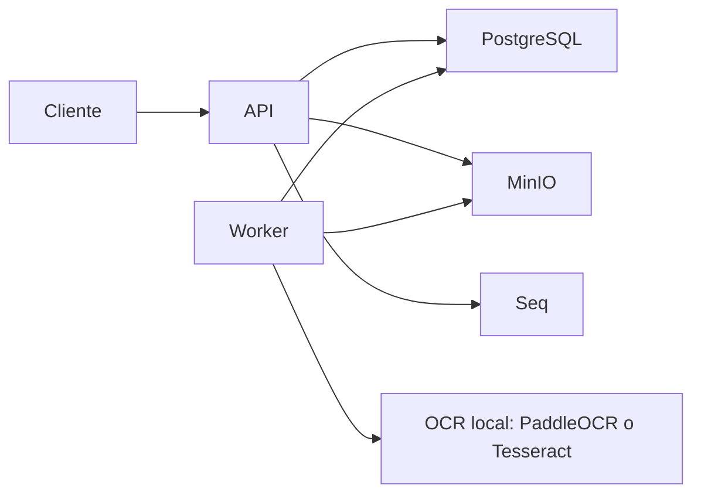

# Arquitectura

Presentation expone Minimal APIs y envía comandos/consultas MediatR a Application. Application contiene entidades, validadores, reglas, catálogos y contratos. Infrastructure implementa repositorios EF Core, almacenamiento MinIO y la cola durable PostgreSQL. Worker ejecuta `ProcessExtractionCommand` en un scope independiente por trabajo.

Con connection string se usa PostgreSQL y migraciones EF versionadas; sin ella se conserva InMemory para pruebas y demostraciones manuales. DbContext y repositorios son scoped. API aplica migraciones y prepara bucket al arrancar; Compose inicia Worker después de que API esté saludable.

La cola OCR vive en la tabla ExtractionJobs. La fila se crea junto a Evidence en una misma transacción. La adquisición es atómica y usa lease, token y hasta 3 intentos. El resultado se almacena en JSONB. Confirmación y creación de lectura comparten transacción. La interfaz de cola antigua basada en delegados permanece por compatibilidad, pero no se utiliza para OCR.

Los archivos se conservan fuera de la base con clave aleatoria y hash. En Compose quedan en MinIO; sin Storage:Endpoint se usa almacenamiento en memoria. No hay deduplicación automática. Consulta [OCR](OCR.md) para contratos, fallos y límites.

FluentValidation se ejecuta mediante pipeline MediatR para comandos registrados en Application. Errores de validación devuelven 400, referencias ausentes 404 y conflictos de estado 409. Los endpoints de lectura/evidencia delegan errores al middleware. La ruta de versión conserva su manejo anterior del template.
