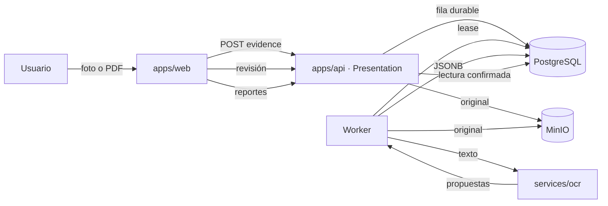
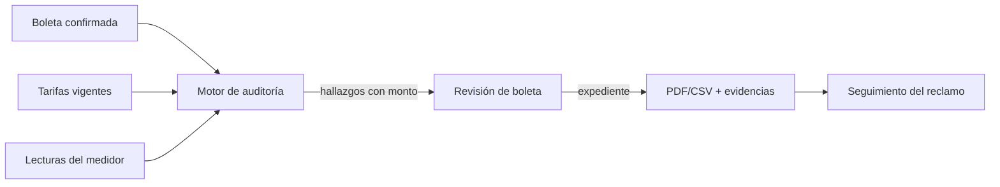

# Arquitectura del monorepo

## Forma

```text
EMeter/
├─ apps/
│  ├─ api/                  .NET 10 · CleanMinimalApi.sln
│  │  ├─ src/Application/    entidades, comandos, consultas, reglas, validadores
│  │  ├─ src/Infrastructure/ EF Core, PostgreSQL, MinIO, cola durable
│  │  ├─ src/Presentation/   Minimal APIs, contratos HTTP, OpenAPI, middleware
│  │  ├─ src/Worker/         host que consume trabajos (OCR hoy, auditoría después)
│  │  ├─ services/ocr/       servicio Python: PaddleOCR/Tesseract + parsers de proveedor
│  │  ├─ tests/              unitarias e integración (Testcontainers)
│  │  └─ docs/               API, dominio, arquitectura, OCR, operación
│  └─ web/                  React 19 + TypeScript + Vite + MUI + TanStack Query
│     ├─ src/features/      catalogs, period-workspace, readings, documents, reports
│     ├─ src/shared/        cliente HTTP, decimales, fechas de Santiago, UI común
│     └─ e2e/               harness Playwright: aislado, full-stack y live
├─ docs/                    producto, brechas, roadmap, plan de entrega, ADR
├─ scripts/github/          sincronización de backlog, hitos, issues y tablero
└─ .github/                 CI, plantillas de issue y de pull request
```

## Flujo actual



El OCR no decide: propone valores con su página, origen y candidatos en conflicto. La
confirmación humana crea una lectura separada y conserva el original.

## Flujo objetivo (auditoría de cobros)



La capa de dinero se agrega como **tres ciudadanos separados** dentro de Application, sin
mezclarse con medición ni consumo:

| Componente | Responsabilidad | No puede |
| --- | --- | --- |
| `Billing` | Boleta, cargos, moneda, totales | Calcular consumo |
| `Tariffs` | Pliego vigente por proveedor, comuna y fecha; componentes y unidades | Decidir si algo es indebido |
| `Auditing` | Reglas deterministas que comparan facturado contra esperado y emiten hallazgos | Modificar la boleta o la lectura |

Esta separación es la decisión [ADR 0002](decisions/0002-capa-de-auditoria.md); preservarla
evita el error clásico de que la regla de negocio termine dentro del endpoint o del parser.

## Persistencia

- PostgreSQL con migraciones EF Core versionadas; sin `EnsureCreated` mezclado.
- Originales en MinIO con clave aleatoria y hash SHA-256; nunca bytes en la base.
- Cola durable en tabla (lease, token, reintentos) para OCR y, después, para auditorías.
- Períodos cerrados inmutables; revisiones y snapshots antes/después en cada mutación.

## Contratos

- JSON camelCase, nulos incluidos, fechas ISO 8601 con offset y persistencia UTC.
- ProblemDetails para 400/404/409; paginación explícita con `hasNextPage`.
- `requestId` para idempotencia y `expectedVersion` para concurrencia optimista.
- OpenAPI generado desde los endpoints; `docs/API.md` documenta el comportamiento.

## Despliegue

Local por diseño: `docker compose up -d --build` levanta API, Worker, PostgreSQL, MinIO, OCR
y Seq. No hay autenticación ni aislamiento de inquilinos todavía: **no exponer a Internet**
hasta completar la fase M6.

## Riesgos estructurales conocidos

| Riesgo | Estado | Mitigación |
| --- | --- | --- |
| Sin identidad ni aislamiento | Abierto | Fase M6, issue #27 |
| Un solo parser real (CGE) | Abierto | Fase M2, issue #13 |
| Importes como texto en OCR | Abierto | Fase M2, issues #9 y #36 |
| Tres definiciones de consumo | Abierto | Fase M1, issue #34 |
| Integración con PostgreSQL no verificada en CI de PR | Abierto | Job `api-integration` fuera de PR |
