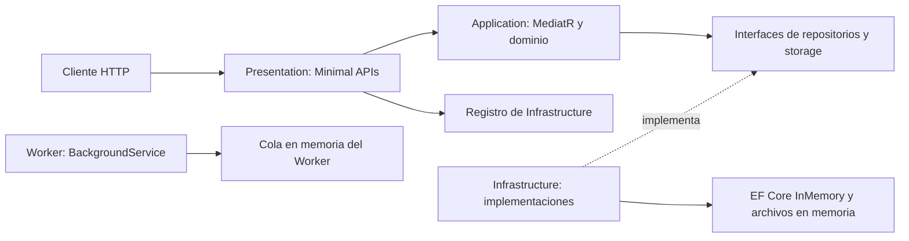

# Arquitectura

[Índice](README.md)

## Proyectos y flujo

| Proyecto | Responsabilidad |
| --- | --- |
| `src/Application` | Entidades, DTOs, comandos, consultas, handlers, reglas y contratos; no depende de Infrastructure |
| `src/Infrastructure` | Repositorios EF Core, configuración de entidades, `IObjectStorage` e `IBackgroundJobQueue`; referencia Application |
| `src/Presentation` | Host web, endpoints, requests, filtros de validación, serialización, OpenAPI y Serilog; referencia Application e Infrastructure para composición |
| `src/Worker` | Host genérico que registra Application e Infrastructure y consume la cola mediante `QueuedBackgroundWorker` |

Las funcionalidades se organizan por dominio. Las lecturas y evidencias usan comandos/consultas de MediatR; los handlers de reportes componen resultados a partir de repositorios. Los mapeos a DTOs son métodos de extensión explícitos: no se usa AutoMapper.

## Persistencia

`AddInfrastructure` registra `UtilityMeterDbContext` como singleton con una base InMemory cuyo nombre contiene un GUID generado al registrar servicios. Los repositorios también son singleton. Cada host tiene sus propios datos; no hay base compartida, migraciones ni proveedor SQL configurado.

El contexto contiene organizaciones, condominios, propiedades, medidores, períodos, lecturas y evidencias. Las configuraciones de entidades están en `Databases/UtilityMeter/Configuration`:

- IDs generados en el dominio (`ValueGeneratedNever`).
- Listas de GUID convertidas a cadenas con comparadores de valor.
- Metadatos de evidencia convertidos a JSON con comparador de diccionarios.
- Alertas como colección propiedad de la lectura (`OwnsMany`).
- `Evidence.RawContent` excluido del modelo.
- Precisión declarada de lectura `18,2` e índices por referencias; InMemory no equivale a las garantías de un motor relacional.

El `DbContext` compartido no está preparado para operaciones concurrentes como una instancia por request. Adoptar una base persistente requiere revisar también los ciclos de vida de servicios y repositorios.

## Archivos y trabajos

`InMemoryObjectStorage` conserva bytes en un `ConcurrentDictionary`. Implementa carga, descarga, eliminación y consulta de existencia, aunque HTTP solo expone carga y asociación/consulta de metadatos. No existe una transacción entre carga del archivo y escritura del registro de evidencia.

`InMemoryBackgroundJobQueue` usa un `Channel` sin límite de capacidad, con un lector y múltiples escritores. Cada trabajo contiene un tipo y un delegado `Func<CancellationToken, Task>`. No es un mensaje serializable para un broker externo.

`QueuedBackgroundWorker` ejecuta trabajos secuencialmente. No incluye reintentos, manejo individual de excepciones, confirmaciones ni cola de fallos. La API registra una cola pero no registra el consumidor; el Worker registra otra cola en su propio proceso. Los flujos de lecturas/evidencias actuales son síncronos y no encolan trabajos.

## HTTP y observabilidad

`ConfigureApplicationBuilder` configura logging, JSON, OpenAPI, validators de Presentation y dependencias. `ConfigureApplication` agrega logging HTTP, Serilog por request, HSTS, redirección HTTPS, Swagger y endpoints.

La serialización usa `AppJsonSerializerContext`, omite nulos y evita ciclos. Al agregar tipos de respuesta revisa ese contexto. Los errores se gestionan dentro de varios endpoints; no hay un middleware común que normalice todos los errores de negocio.

## Extender el servicio

- **Nuevo caso de uso:** define comando/consulta y handler en Application; agrega el endpoint y DTO correspondiente. Registra la validación del tipo que realmente recibe HTTP o incorpora un pipeline de comandos explícito.
- **Persistencia real:** reemplaza el proveedor en Infrastructure, revisa relaciones, migraciones, concurrencia y lifetimes. Verifica los repositorios con ese motor.
- **Almacenamiento externo:** implementa `IObjectStorage`, conserva claves/hashes y define consistencia, límites y descarga autorizada.
- **Procesamiento distribuido:** cambia delegados en memoria por mensajes serializables, implementa un transporte compartido y define reintentos e idempotencia.

Los archivos `*Feature.cs` que solo declaran `FeatureName` no implementan CRUD ni endpoints. Los planes de `.github/plans` son material de evolución, no una lista de capacidades disponibles.
