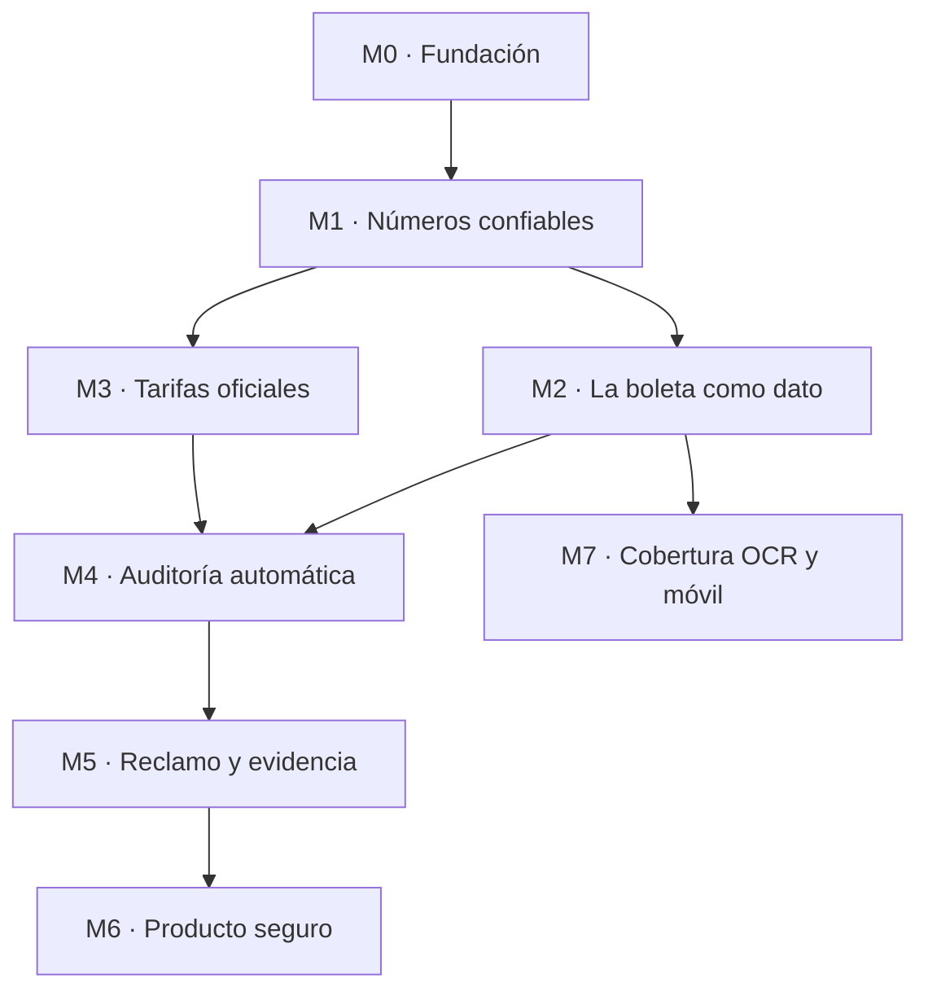

# Roadmap

## Cómo se ordena

El orden no es por facilidad técnica sino por **dependencia de datos**:

1. Sin cifras confiables no se puede auditar nada (M1).
2. Sin boleta persistida no hay nada que auditar (M2).
3. Sin tarifa oficial no hay precio esperado contra el cual comparar (M3).
4. Sin reglas no hay hallazgo (M4).
5. Sin expediente el usuario detecta pero no puede reclamar (M5).
6. Sin identidad no se puede abrir a personas reales (M6).

M2 y M3 pueden avanzar en paralelo. M7 (calidad OCR) también, en cuanto exista boleta
persistida. El camino crítico es **M1 → M2 → M4 → M5 → M6**.

## Resumen

| Fase | Objetivo | Criterio de salida | Esfuerzo (días-persona) | Hito |
| --- | --- | --- | --- | --- |
| **M0** | Un repositorio, CI y documentación | `main` compila, CI en verde, backlog y tablero publicados | 5 | 17 nov 2026 |
| **M1** | Que ninguna cifra se lea como un dato que no es | Cero S1 abiertos; desconocido nunca se muestra como cero; unidades validadas por recurso | 21 | 18 dic 2026 |
| **M2** | Boleta persistida con cargos y evidencia | Se puede cargar una boleta, verla estructurada y reabrirla sin OCR | 15 | 15 ene 2027 |
| **M3** | Tarifa oficial vigente por proveedor y comuna | Una boleta resuelve su tarifa aplicable o declara que no la tiene | 11 | 5 feb 2027 |
| **M4** | Hallazgos con monto en disputa | Una boleta real produce hallazgos explicables y reejecutables | 22 | 12 mar 2027 |
| **M5** | Reclamo presentable y seguimiento | Un hallazgo se convierte en expediente PDF y en reclamo con estado | 11 | 2 abr 2027 |
| **M6** | Identidad y aislamiento | Dos usuarios no ven los datos del otro; mutaciones auditadas | 12 | 30 abr 2027 |
| **M7** | Calidad medida y captura móvil | Precisión publicada por proveedor y campo; captura sin señal | 9 | 21 may 2027 |

Total: **106 días-persona** de ingeniería, incluidos pruebas y documentación. El calendario
asume una persona a tiempo parcial con apoyo de agentes; es una referencia, no un compromiso.

## Fase por fase

### M0 · Fundación del monorepo — *hecho*

Un solo repositorio con historial de ambos proyectos, CI de cuatro jobs, plantillas, guía de
contribución, documentación de producto, arquitectura, brechas y roadmap, y tablero con el
backlog versionado.

- #1 Importar backend y frontend a un monorepo con historial
- #2 CI de build y pruebas para api, ocr y web
- #3 Documentar arquitectura, brechas, roadmap y tablero

### M1 · Números confiables — *en curso*

Cierra los defectos que hoy permiten cifras incorrectas y elimina las tres formas en que la
interfaz presenta un dato desconocido como cero.

*Confiabilidad de datos:* #31 período cerrado, #32 períodos solapados, #33 unidad por recurso,
#34 un solo cálculo de consumo, #35 formato decimal determinista, #36 parser de números,
#37 idempotencia de confirmación.

*Presentación y uso:* #4 desconocido ≠ cero, #5 unidades y decimales, #6 precarga del OCR,
#7 estimada vs real, #8 foco y teclado.

**Salida:** ninguna prueba puede producir un 201 en un período cerrado; ningún importe leído
por el OCR cambia de valor; ninguna pantalla muestra `0` donde falta el dato.

### M2 · La boleta como dato

Convierte el resultado del OCR en una entidad de dominio con cargos tipados y evidencia, en
lugar de un JSON que se descarta.

- #9 Modelo `Bill` + `BillLineItem` con migración e inmutabilidad por período
- #10 API de boletas con idempotencia y filtros
- #11 Confirmación OCR crea boleta sin duplicar
- #12 UI de carga y revisión con original al lado
- #13 Multi-proveedor: al menos dos parsers nuevos y detección honesta

**Salida:** una boleta cargada sobrevive al reinicio y se puede consultar sin volver a procesar
el documento.

### M3 · Tarifas oficiales

- #14 Investigar fuentes y formato de los pliegos (spike con entregable)
- #15 Catálogo con vigencia, comuna y componentes
- #16 Importación atómica y API de consulta
- #17 UI de administración con detección de huecos y superposiciones

**Salida:** para una boleta de una comuna soportada, el sistema resuelve la tarifa aplicable a
la fecha facturada y puede citar su norma de origen.

### M4 · Auditoría automática

El producto propiamente tal. Cada regla es determinista, tiene tolerancia declarada y produce
una explicación reproducible.

- #18 Motor `AuditRun`/`AuditFinding`
- #19 Cuadre: suma de cargos, período, duplicados, redondeos
- #20 Tarifa: cargo fijo y cargo variable contra pliego
- #21 Consumo: facturado vs medido, constante, estimadas, retroactivos
- #22 Revisión con monto en disputa y acción de aceptar/descartar
- #23 Ejecución asíncrona en el Worker y recálculo dirigido

**Salida:** una boleta real produce al menos un hallazgo con monto, tolerancia y explicación, y
el total en disputa es reproducible a mano.

### M5 · Reclamo y evidencia

- #24 Expediente PDF/CSV con evidencias y trazabilidad
- #25 Seguimiento del reclamo y escalamiento
- #26 Serie histórica y detección de saltos

**Salida:** desde un hallazgo se genera un documento presentable y se registra su respuesta.

### M6 · Producto seguro

- #27 Autenticación, multi-tenant y auditoría de identidad
- #28 Endurecimiento y operación
- #38 No filtrar trazas ni registrar 500 donde hubo 400
- #39 Evidencia inexistente responde 404

**Salida:** dos organizaciones conviven sin filtrarse datos y el despliegue tiene respaldo
probado y alertas.

### M7 · Cobertura OCR y móvil

- #29 Corpus anonimizado y evaluación de precisión por proveedor y campo
- #30 PWA y captura móvil

**Salida:** precisión publicada y repetible; una captura hecha sin señal llega sin duplicar.

## Riesgos del plan

| Riesgo | Impacto | Mitigación |
| --- | --- | --- |
| Los pliegos tarifarios no están en formato consumible | Bloquea M3 | Spike #14 primero; si no hay fuente estable, cargar tarifas manualmente con vigencia y fuente |
| Un solo proveedor real de boletas (CGE) | M4 sirve a pocos | #13 antes de M4; el motor de reglas no depende del proveedor |
| Precisión OCR insuficiente en totales | Hallazgos falsos | Umbral de confianza y revisión obligatoria; #29 antes de abrir a usuarios |
| El alcance crece hacia asesoría legal | Distrae del producto | El producto detecta y documenta; no interpreta la ley ni garantiza resultados |
| Sin usuarios reales para validar | Se construye lo que nadie usa | M1 y M2 se prueban con 3 boletas reales anonimizadas antes de seguir |

## Fuera de alcance

Pagos, cálculo de tarifas propias, integración con sistemas de las distribuidoras, asesoría
legal, machine learning para predicción de consumo y cualquier cálculo sin fuente citable.

## Cómo se mantiene este roadmap

El backlog vive en `docs/backlog/*.md`: un archivo por fase, con el título del issue, sus
etiquetas, su esfuerzo y el criterio de aceptación. `scripts/github/sync.ps1` lo sincroniza con
GitHub de forma idempotente (etiquetas, hitos, issues y campos del tablero). Cambiar el plan es
editar un archivo markdown y volver a ejecutar el script.
