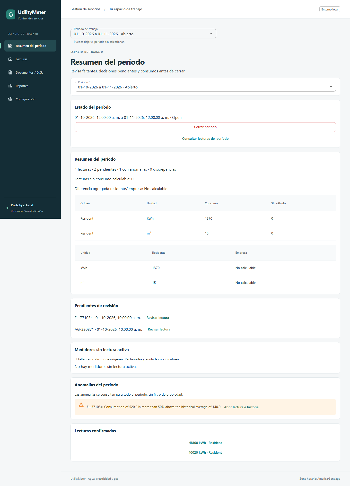
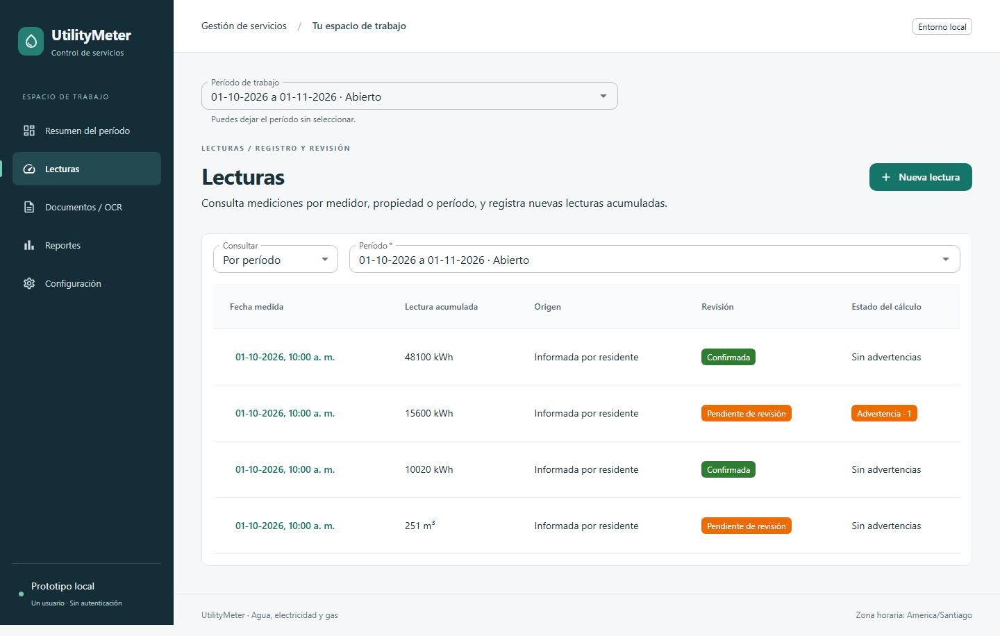
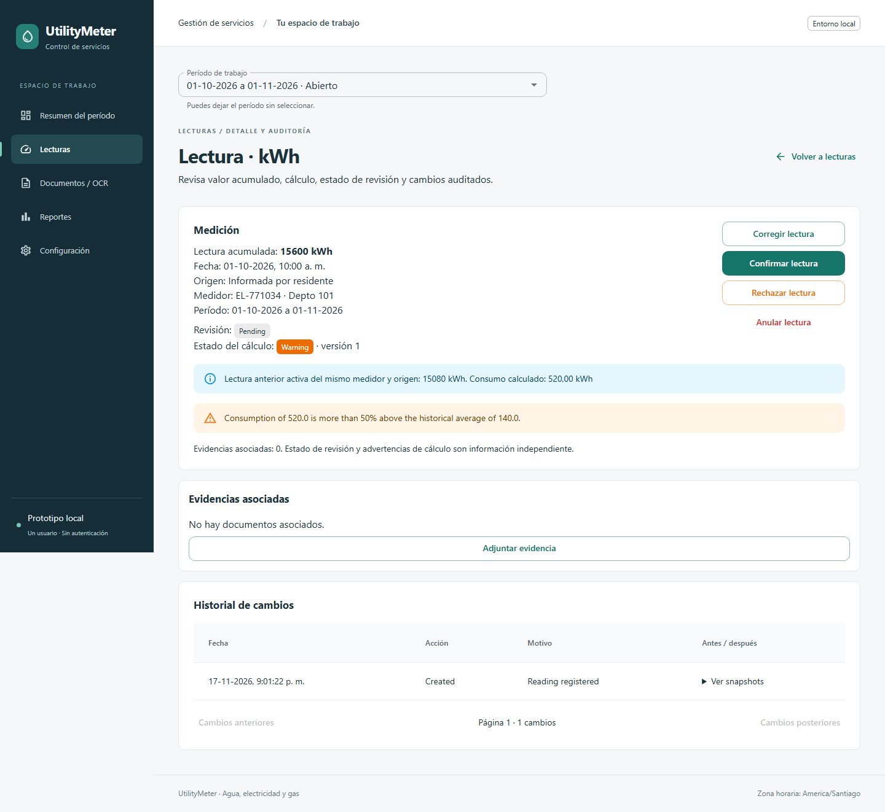
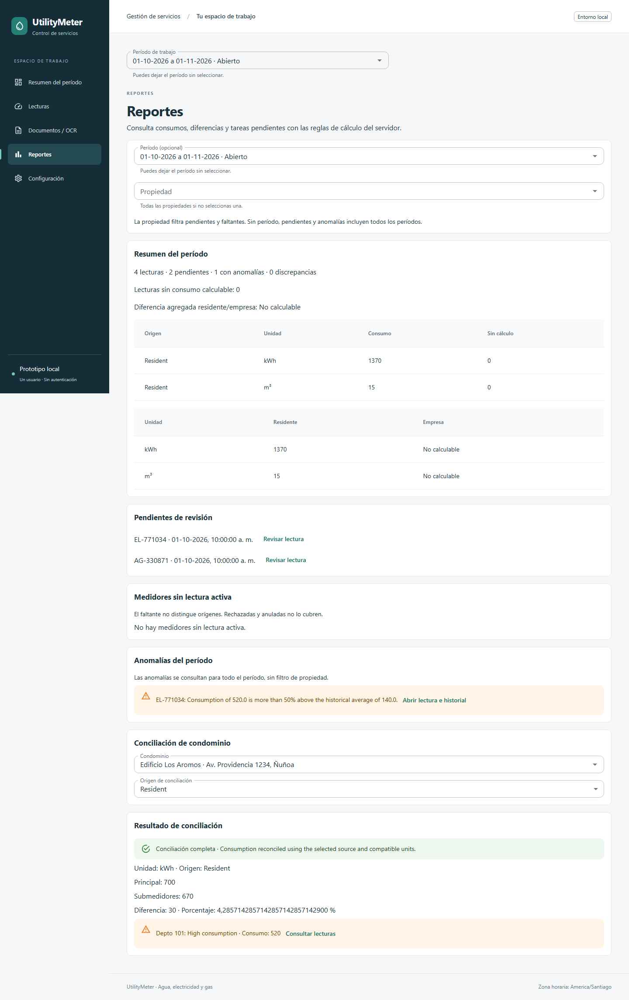
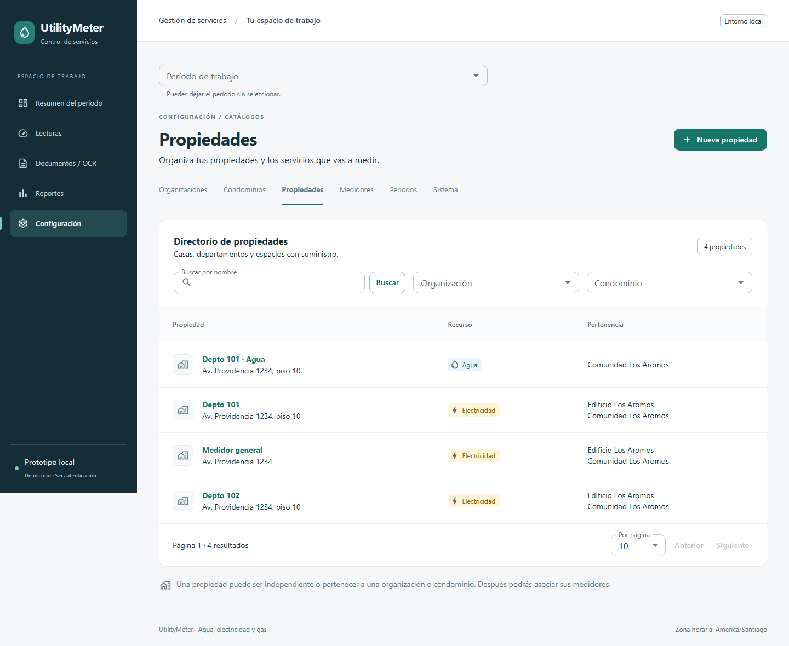
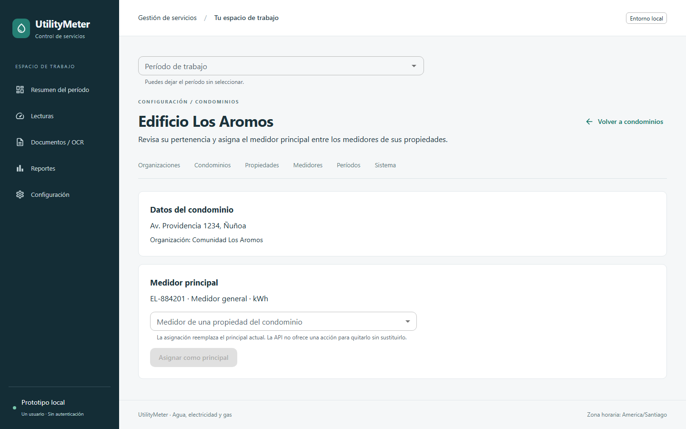
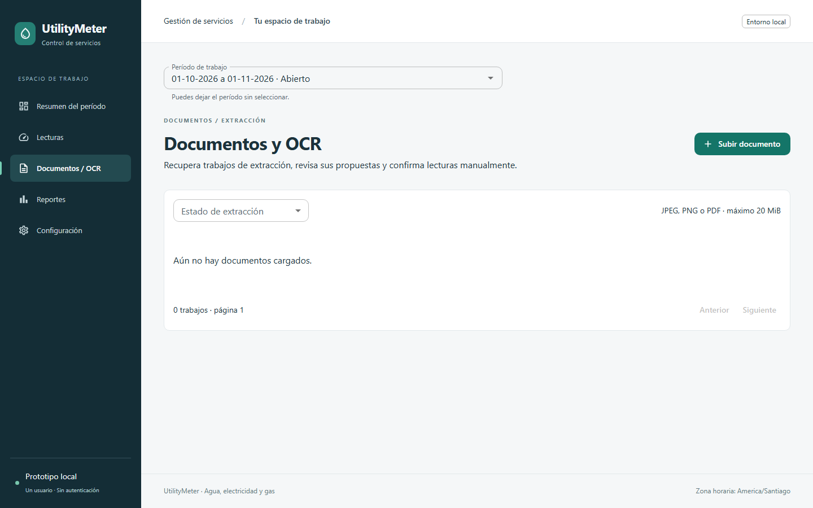

# Capturas

Imágenes tomadas del prototipo real el 17 de noviembre de 2026, con datos de demostración
creados por `scripts/demo/seed-demo.ps1`: un condominio con medidor general y dos submedidores,
una propiedad de agua y cuatro meses de lecturas.

Son capturas honestas: muestran lo que hay, incluidos los defectos que el roadmap corrige. Por
ejemplo, el porcentaje de conciliación aparece sin redondear y varios estados del dominio se ven
en inglés; ambos están registrados como issues de la fase M1.

## Resumen del período



El espacio de trabajo del período reúne faltantes, pendientes, anomalías y consumos antes del
cierre. Es la pantalla de entrada: responde «¿qué me falta revisar este mes?».

## Lecturas



Lecturas del período con origen, estado de revisión y advertencias de cálculo. Hoy la tabla no
identifica el medidor de cada fila; es el issue de listados de M1.

## Detalle de una lectura



Lectura acumulada, medidor, período, lectura anterior y consumo calculado, con la alerta de
consumo anómalo y el historial auditado. Los estados `Pending`, `Warning` y `Created` todavía se
muestran sin traducir.

## Reportes y conciliación



Cinco reportes con las reglas del servidor. La conciliación del condominio compara el medidor
general (700 kWh) con la suma de submedidores (670 kWh), informa una diferencia de 30 kWh y
señala al Depto 101 por consumo alto. El porcentaje se imprime con demasiados decimales: es el
defecto de formato de M1.

## Configuración



Catálogo de propiedades con paginación, búsqueda y filtros. Los catálogos conservan metadatos al
editar y no se borran físicamente.



Detalle de condominio con su medidor principal y sus propiedades.

## Documentos y OCR



Bandeja de documentos para subir boletas y revisar extracciones. En este entorno no hay Worker ni
servicio OCR en ejecución, así que la bandeja aparece vacía: la subida y el procesamiento
requieren el stack completo con `docker compose up -d --build`.

## Cómo regenerarlas

```powershell
# API en memoria
dotnet run --project apps/api/src/Presentation -- --urls http://127.0.0.1:5032 --environment local

# Datos de demostración
./scripts/demo/seed-demo.ps1

# Cliente
cd apps/web; $env:VITE_API_BASE_URL='http://127.0.0.1:5032'; npm run dev

# Capturas
node scripts/capture-wiki.mjs --period <id> --condominium <id> \
  --condominium-name "Edificio Los Aromos" --reading <id>
```
