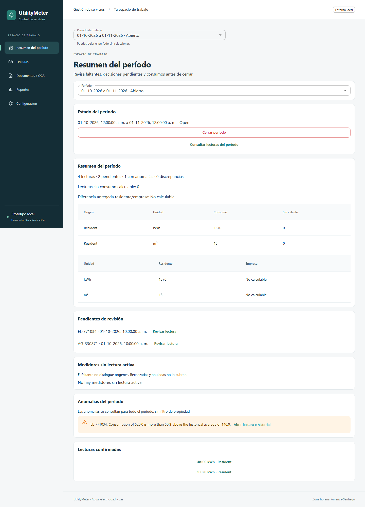

# EMeter · wiki

Prototipo para **auditar boletas de servicios básicos**: mide, lee la boleta con OCR y —cuando
la capa de dinero esté completa— detecta cobros irregulares con un monto en disputa.

*Captura real del prototipo con datos de demostración. Más pantallas en [Capturas](Capturas).*

## Estado en una frase

La medición funciona y está probada; la auditoría de cobros todavía no existe. El plan para
llegar está en el [roadmap](https://github.com/cbinput/EMeter/blob/main/docs/ROADMAP.md).

## Navegación

| Página | Contenido |
| --- | --- |
| [Producto](Producto) | Problema, personas, principios y métricas |
| [Capturas](Capturas) | Pantallas reales de la aplicación |
| [Arquitectura](Arquitectura) | Monorepo, flujos, persistencia y capa de auditoría |
| [Operación](Operacion) | Cómo levantar el stack y qué revisar cuando falla |
| [Roadmap](Roadmap) | Fases, criterios de salida y esfuerzo |
| [Decisiones](Decisiones) | ADR: monorepo y capa de auditoría |
| [Contribuir](Contribuir) | Cómo participar, verificar y reportar |

## Enlaces rápidos

- [Repositorio](https://github.com/cbinput/EMeter)
- [Tablero del roadmap](https://github.com/users/cbinput/projects/3)
- [Issues](https://github.com/cbinput/EMeter/issues)
- [Análisis de brechas](https://github.com/cbinput/EMeter/blob/main/docs/GAP-ANALYSIS.md)
- [Plan de ejecución con DeepSeek](https://github.com/cbinput/EMeter/blob/main/docs/DELIVERY-PLAN.md)

## Cómo se mantiene

El backlog vive versionado en `docs/backlog/` y se publica con
`scripts/github/sync.ps1`. La wiki resume decisiones estables; el detalle técnico vive en
`apps/api/docs/` y `apps/web/`.

## Estado de apertura

Listo para que alguien lo encuentre y pueda trabajar:

| Elemento | Estado |
| --- | --- |
| Licencia MIT, README con estado honesto, guía de contribución | ✅ |
| Código de conducta y política de seguridad con reporte privado | ✅ |
| CI de cuatro jobs (API, OCR, web e integración) | ✅ |
| Wiki con capturas reales y pasos para regenerarlas | ✅ |
| Roadmap con fases, esfuerzo y criterios de salida | ✅ |
| 41 issues en 8 hitos, tablero con Fase y Esfuerzo, `good first issue` | ✅ |
| Semilla de demostración reproducible y script de capturas | ✅ |

Pendiente antes de anunciarlo más allá del repositorio:

- README en inglés para quien no lee español.
- Decidir qué pasa con los repositorios anteriores (`cbinput/UtilityMeter`), que quedaron atrás
  del monorepo.
- Un tag de versión (`v0.1.0`) que marque la línea base.
- Demo pública: hoy es local por diseño, porque no hay autenticación.
- Llevar al CI las pruebas de navegador, que hoy sólo se ejecutan a mano.
